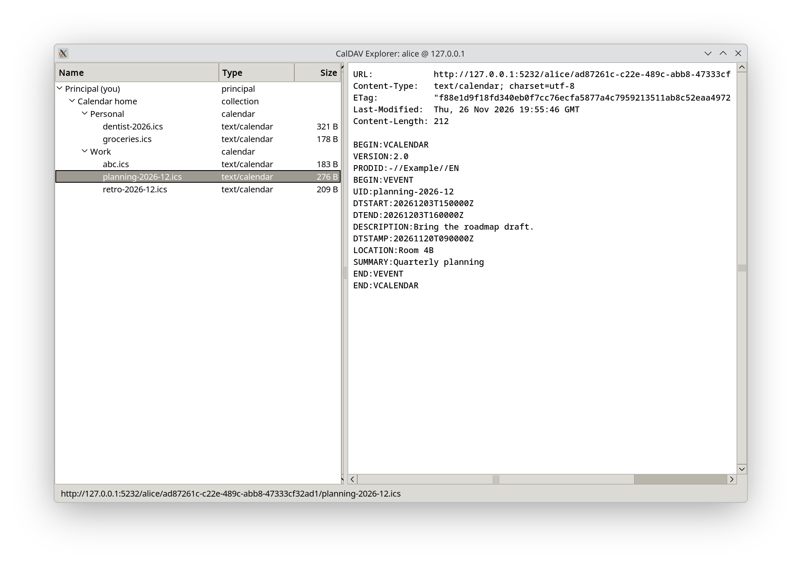

# caldav-explorer

A read-only desktop app for browsing your own CalDAV data.



## How to run it

The script requires:

- Python 3
- `tkinter`
- `caldav`

### Run with uv

The easiest way to run it is with [uv](https://docs.astral.sh/uv/). You don't
need to clone or download the repository for this.

```sh
uv run https://raw.githubusercontent.com/lbussell/caldav-explorer/refs/heads/main/caldav_explorer.py
```

### Ubuntu

Tested on Ubuntu 24.04.

```sh
sudo apt install python3-tk python3-caldav
python3 caldav_explorer.py
```

### Other distros

If your distribution doesn't package `caldav` (cough cough, Fedora), you can install it in a venv:

```sh
python3 -m venv .venv
.venv/bin/pip install caldav
.venv/bin/python caldav_explorer.py
```
